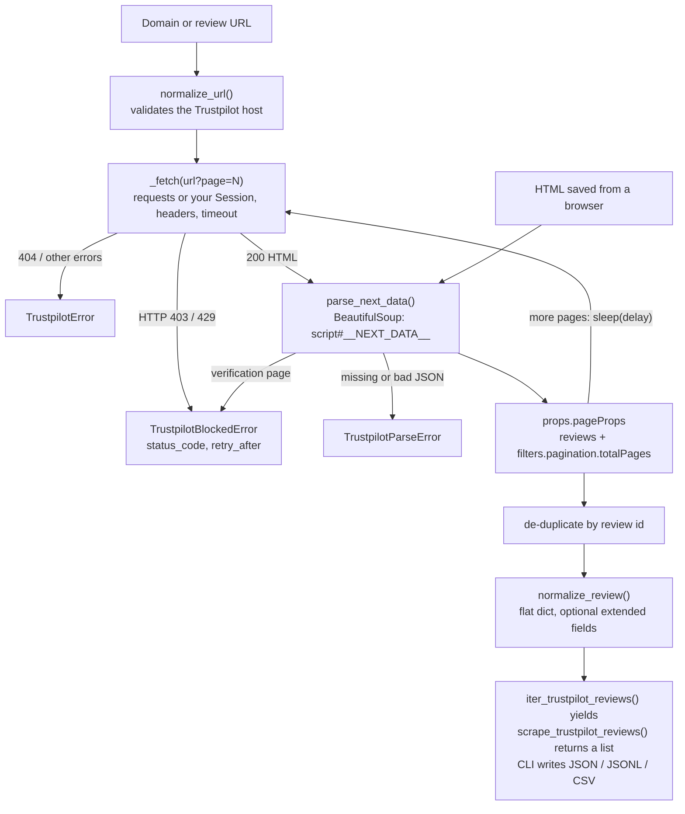

# trustpilot-scraper

**Turn a company's public Trustpilot reviews into clean Python dicts, CSV or JSON, and fail loudly instead of returning an empty list when Trustpilot says no.**

[](https://pypi.org/project/trustpilot_scraper/)
[](https://pypi.org/project/trustpilot_scraper/)
[](https://pepy.tech/projects/trustpilot_scraper)
[](https://github.com/irfanalidv/trustpilot_scraper/actions/workflows/tests.yml)
[](https://github.com/irfanalidv/trustpilot_scraper/actions/workflows/codeql.yml)
[](https://github.com/irfanalidv/trustpilot_scraper/blob/main/LICENSE)
[](https://github.com/astral-sh/ruff)
[](https://mypy-lang.org/)
[](https://github.com/irfanalidv/trustpilot_scraper/blob/main/CONTRIBUTING.md)

> **Heads-up (October 2026):** Trustpilot currently puts an AWS WAF bot-verification page in front
> of its review pages, and plain HTTP clients such as `requests` usually get **HTTP 403**. We
> re-checked this on 2026-10-31. When it happens the library raises `TrustpilotBlockedError`
> rather than quietly returning nothing. It does not try to get around the check. Instead, save
> the page from your browser and parse it with `parse_reviews_html()`, as the quickstart shows.

## Why

Review scrapers usually break in one of two quiet ways: CSS selectors rot after a redesign, or a
block page comes back and the script happily reports zero reviews. This library reads the JSON
Trustpilot embeds in every review page (`__NEXT_DATA__`) instead of the visual markup, and it
raises a specific exception for blocks, missing pages and malformed data. The same parser works
on HTML you fetched yourself, so a page saved from your browser is a first-class input.

## Features

- Reads the page's embedded `__NEXT_DATA__` JSON instead of brittle CSS selectors.
- Paginates automatically and stops at the real last page (`filters.pagination.totalPages`) or at
  `max_pages`.
- Returns `Date`, `Author`, `Body`, `Heading`, `Rating` and `Location`. With `extended=True` it
  also returns `ReviewId`, `ExperienceDate`, `Verified`, `Likes`, `Language`, `Reply` and
  `ReplyDate`.
- De-duplicates by review id and keeps page order.
- Polite defaults: 2 s between pages, a 30 s timeout, and an honest `User-Agent` that links back
  to this project.
- Accepts your own `requests.Session` (proxies, cookies, connection reuse, or a test adapter), and
  headers you set on it are not overridden.
- Raises clear exceptions: `TrustpilotBlockedError` (with `status_code` and `retry_after`),
  `TrustpilotParseError` and `TrustpilotError`.
- Accepts only real Trustpilot hosts, so a typo cannot send requests to a look-alike domain.
- A `trustpilot-scraper` command that writes JSON, JSONL or CSV.
- Typed (`py.typed`, checked with mypy) and light: only `requests` and `beautifulsoup4`.

## Install

```bash
pip install trustpilot_scraper
# or
uv add trustpilot_scraper

# optional: pandas, for working with results as a DataFrame
pip install "trustpilot_scraper[pandas]"
```

Requires Python 3.10 to 3.13.

## Quickstart

Try the live site, and fall back to a page saved from your browser (File > Save Page As) when
Trustpilot blocks the request:

```python
from pathlib import Path

from trustpilot_scraper import (
    TrustpilotBlockedError,
    normalize_review,
    parse_reviews_html,
    scrape_trustpilot_reviews,
)

try:
    reviews = scrape_trustpilot_reviews("www.amazon.com", max_pages=1)
except TrustpilotBlockedError as exc:
    print(f"Blocked (HTTP {exc.status_code}); using a page saved from the browser")
    html = Path("page.html").read_text(encoding="utf-8")
    reviews = [normalize_review(r) for r in parse_reviews_html(html)]

for review in reviews[:2]:
    print(review)
```

Output from a run on 2026-10-31. The live request was blocked, and `page.html` was one of the
synthetic sample pages from
[`examples/data/`](https://github.com/irfanalidv/trustpilot_scraper/tree/main/examples/data):

```text
Blocked (HTTP 403); using a page saved from the browser
{'Date': '2026-10-28', 'Author': 'Sample Reviewer 1', 'Body': 'Parcel arrived a day early and the tracking was spot on.', 'Heading': 'Arrived a day early', 'Rating': 5, 'Location': 'GB'}
{'Date': '2026-10-28', 'Author': 'Sample Reviewer 2', 'Body': 'Fast delivery, though I got five text messages about it.', 'Heading': 'Fast but noisy updates', 'Rating': 4, 'Location': 'NL'}
```

When the live request does succeed, `reviews` has exactly the same shape.

### Command line

```bash
trustpilot-scraper www.example.com --max-pages 3 -o reviews.csv
trustpilot-scraper https://www.trustpilot.com/review/www.example.com --extended -o reviews.jsonl
trustpilot-scraper www.example.com --all-pages --delay 5 -o reviews.json
trustpilot-scraper www.example.com      # first page, JSON to stdout
python -m trustpilot_scraper --version
```

When a request is blocked or fails, the error goes to stderr and the exit code is `1`.

## How it works



Key design decisions:

- **Data, not markup.** Trustpilot is a Next.js app, and the review list arrives as JSON inside
  `<script id="__NEXT_DATA__">`. That JSON changes far less often than the CSS classes.
- **Errors are values you can act on.** Blocks, missing pages and parse failures raise distinct
  exceptions, so a scheduled job can back off on `TrustpilotBlockedError.retry_after` instead of
  writing an empty file.
- **One parser for every source.** `iter_trustpilot_reviews` and `parse_reviews_html` share the
  same parsing and normalisation, so offline HTML and live pages produce identical dicts.
- **Lazy by default.** `iter_trustpilot_reviews` fetches a page only when you ask for its reviews;
  `scrape_trustpilot_reviews` is just `list(iter_...)`.
- **Bring your own transport.** Every network call goes through `requests.get` or the `Session` you
  pass, which makes the library easy to proxy, rate-limit further, or test offline.

## Use cases and recipes

The offline examples use synthetic saved pages for two invented companies, so they never contact
Trustpilot. The test suite runs them.

| Script | What it shows | Needs |
| --- | --- | --- |
| [`complaint_themes.py`](https://github.com/irfanalidv/trustpilot_scraper/blob/main/examples/complaint_themes.py) | Support triage: rating distribution, reply coverage, themes in 1-2 star reviews, oldest unanswered complaint | offline |
| [`competitor_benchmark.py`](https://github.com/irfanalidv/trustpilot_scraper/blob/main/examples/competitor_benchmark.py) | Two companies side by side: average rating, 1-star share, verified share, reply rate, median reply time | offline |
| [`monthly_trend_pandas.py`](https://github.com/irfanalidv/trustpilot_scraper/blob/main/examples/monthly_trend_pandas.py) | `pandas.DataFrame(reviews)`, monthly trend, per-country ratings, CSV export | offline, `[pandas]` |
| [`offline_pipeline_test.py`](https://github.com/irfanalidv/trustpilot_scraper/blob/main/examples/offline_pipeline_test.py) | Test your pipeline offline: a `requests` transport adapter serves saved pages to the real pagination loop, including a simulated 403 | offline |
| [`live_scrape.py`](https://github.com/irfanalidv/trustpilot_scraper/blob/main/examples/live_scrape.py) | Polite live scrape that respects `retry_after` and explains the save-from-browser fallback | network |

```bash
python examples/competitor_benchmark.py
```

```text
metric                  brightparcel     swiftcart
reviews                           24            16
avg rating                      3.42          3.31
1-star share                     25%           12%
verified share                   79%           81%
reply rate                       54%           31%
median reply (days)              2.0           3.0
```

<details>
<summary>More snippets: extended fields, explicit error handling, your own Session</summary>

These need network access and will usually raise `TrustpilotBlockedError` while Trustpilot's
verification page is active.

```python
import time

import requests

from trustpilot_scraper import (
    TrustpilotBlockedError,
    TrustpilotError,
    iter_trustpilot_reviews,
)

session = requests.Session()
session.headers["User-Agent"] = "acme-research/1.0 (data-team@acme.example)"  # kept as-is

try:
    for review in iter_trustpilot_reviews(
        "www.example.com", max_pages=3, delay=5.0, extended=True, session=session
    ):
        print(review["Date"], review["Rating"], review["Verified"], bool(review["Reply"]))
except TrustpilotBlockedError as exc:
    print(f"blocked (HTTP {exc.status_code})")
    if exc.retry_after:
        time.sleep(exc.retry_after)  # back off before any later attempt
except TrustpilotError as exc:
    print("request failed:", exc)
```

</details>

## Configuration

There are no environment variables. Everything is a function argument or CLI flag.

| Option | Default | CLI flag | Meaning |
| --- | --- | --- | --- |
| `max_pages` | `None` (all) | `--max-pages N` (default 1), `--all-pages` | Stop after this many pages |
| `delay` | `2.0` | `--delay S` | Seconds to sleep between page requests |
| `timeout` | `30.0` | `--timeout S` | Per-request timeout in seconds |
| `extended` | `False` | `--extended` | Add `ReviewId`, `ExperienceDate`, `Verified`, `Likes`, `Language`, `Reply`, `ReplyDate` |
| `session` | `None` | | A `requests.Session` to use; headers you set on it take precedence |
| output | stdout JSON | `-o FILE` | `.csv`, `.jsonl` or `.json` (anything else is written as JSON) |

`trustpilot_scraper.scraper.DEFAULT_HEADERS` holds the default `User-Agent`, `Accept` and
`Accept-Language`.

## API overview

| Name | Purpose |
| --- | --- |
| `scrape_trustpilot_reviews(base_url, *, max_pages=None, delay=2.0, extended=False, session=None, timeout=30.0)` | Fetch every page (or `max_pages`) and return a list of dicts |
| `iter_trustpilot_reviews(...)` | Same arguments, as a lazy generator that fetches page by page |
| `get_reviews_from_page(url, *, session=None, timeout=30.0)` | Fetch one page and return the raw Trustpilot review objects |
| `parse_reviews_html(html)` | Raw review objects from an HTML string (for example a saved page) |
| `parse_next_data(html)` | The whole decoded `__NEXT_DATA__` JSON |
| `normalize_review(raw, *, extended=False)` | A raw review object as the flat dict shown above |
| `normalize_url(company)` | `"www.example.com"` becomes `"https://www.trustpilot.com/review/www.example.com"`; non-Trustpilot hosts raise `ValueError` |
| `TrustpilotError` | Base exception (a `RuntimeError`) |
| `TrustpilotBlockedError` | HTTP 403/429 or a verification page; has `status_code` and `retry_after` |
| `TrustpilotParseError` | The page has no usable review data |

<details>
<summary>Upgrading from 0.x</summary>

- `from trustpilot_scraper.scraper import scrape_trustpilot_reviews` still works, and the output
  keys are unchanged.
- Version 0.10 on PyPI shipped a wheel without the Python package in it. 1.0.0 fixed the packaging.
- Errors raise exceptions instead of returning `[]`.
- `pandas` is no longer a required dependency.

</details>

## When to use it

- **Use it** to collect public reviews for research, sentiment analysis or benchmarking at a gentle
  pace, or to parse review pages you saved yourself.
- **Use Trustpilot's official APIs** if you manage the business profile or have API access. They
  are the sanctioned route for production integrations.
- **Do not use it** to scrape at volume, to collect personal data beyond what you need, or to get
  around Trustpilot's access controls. The library deliberately does none of that.

## Responsible use

Only scrape public pages, and keep the request rate low (the default delay is 2 s). Follow
Trustpilot's terms of use and the data-protection law that applies to you. Review texts and
reviewer names are personal data in many jurisdictions. If Trustpilot blocks you, stop and use a
saved page or the official API rather than trying to evade the block.

## Roadmap

- Parse business-level fields (`businessUnit`: TrustScore, review count) into a helper.
- Optional language and star-rating filters mapped to Trustpilot's query parameters.
- Retry helper that waits for `retry_after` before trying again, off by default.

## Contributing, security, citation, license

- Pull requests are welcome. See [CONTRIBUTING.md](https://github.com/irfanalidv/trustpilot_scraper/blob/main/CONTRIBUTING.md)
  and the [Code of Conduct](https://github.com/irfanalidv/trustpilot_scraper/blob/main/CODE_OF_CONDUCT.md).
  The dev loop is `pip install -e ".[dev]"`, then
  `ruff check . && ruff format --check . && mypy trustpilot_scraper && pytest --cov=trustpilot_scraper`.
  Tests run offline against saved HTML fixtures.
- Report vulnerabilities as described in [SECURITY.md](https://github.com/irfanalidv/trustpilot_scraper/blob/main/SECURITY.md).
- To cite this project, use [CITATION.cff](https://github.com/irfanalidv/trustpilot_scraper/blob/main/CITATION.cff).
- Release notes are in [CHANGELOG.md](https://github.com/irfanalidv/trustpilot_scraper/blob/main/CHANGELOG.md).
- MIT licensed. See [LICENSE](https://github.com/irfanalidv/trustpilot_scraper/blob/main/LICENSE).
